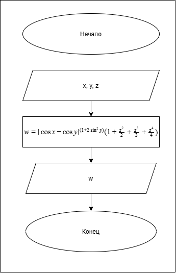

# Домашнее задание к работе 5
## Условие задачи
Создать программу вычисления указанной величины. Результат проверить при заданных исходных значениях.

## 1. Алгоритм и блок-схема

### Алгоритм
1. **Начало**
2. Задать исходные числа x, y, z:
   - `x`.
   - `y`.
   - `z`.
3. Вычислить значение w по заданному выражению:
   $w = |\cos x - \cos y|^{(1 + 2\sin^2 y)}(1 + \frac{z^2}{2} + \frac{z^3}{3} + \frac{z^4}{4})$.
4. Вывести результаты расчетов с подстановкой всех значений в текст.
5. **Конец**

### Блок-схема


## 2. Реализация программы

```C
#define _CRT_SECURE_NO_WARNINGS
#include <stdio.h>
#include <locale.h>
#include <math.h>

int main()
{
    setlocale(LC_CTYPE, "RUS.UTF-8");

    double w, x, y, z;

    puts("Введите x, y, z (через пробел): ");
    scanf("%lf %lf %lf", &x, &y, &z);
    w = pow(fabs(cos(x) - cos(y)), 1 + 2*pow(sin(y), 2)) * (1 + z + pow(z, 2)/2 + pow(z, 3)/3 + pow(z, 4)/4);
    printf("При x = %f,\ny = %f,\nz = %f:\n  w = %.4f.", x, y, z, w);
}
```
## 3. Результаты работы программы

При x = 4000.000000,
y = -0.875000,
z = -0.000475:
  w = 1.9873.

## 4. Информация о разработчике

бТИИ-261 Иголкин Максим Александрович
